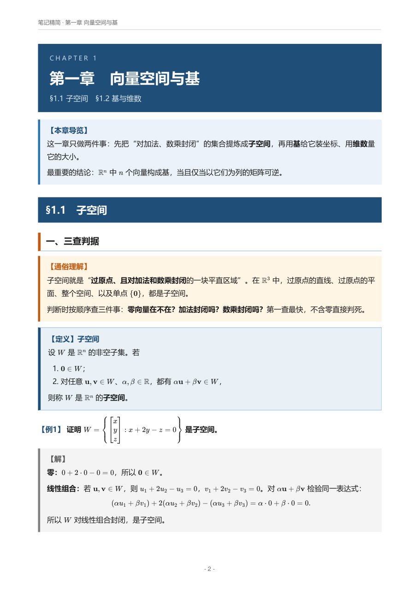

# notesbrevity

**Turn lecture notes into clean Chinese PDFs.** A Claude Code skill + a tiny
HTML/KaTeX → Chrome → PDF build pipeline. No LaTeX installation required.



## Why

Handwritten notes and English course notes are hard to revise from. This skill
turns them into compact Chinese lecture notes with a consistent structure:

> 通俗理解 → 定义/定理 → 证明思路 → 例题 → 练习（附答案）→ 易错提醒

Each chapter ends with a summary table and a one-page memory sheet. The output
is an A4 PDF with running headers, page numbers, and a PDF outline.

## Features

- **Chinese-first typography** — Microsoft YaHei / PingFang / Noto Sans CJK.
- **Real math** — KaTeX renders matrices, fractions, aligned equations, cases.
- **Print-ready** — A4, 22/19/20/19 mm margins, navy section bands, coloured boxes.
- **Navigation** — per-chapter running headers, `- n -` footers, chapter bookmarks.
- **Offline** — KaTeX is vendored in `assets/katex/`; no CDN, no npm, no network.
- **Small files** — PyMuPDF subsets embedded fonts (≈14 MB → ≈2 MB).
- **One command** — `python build.py mynotes`.

## Install

```bash
git clone https://github.com/lijunrui29/notesbrevity.git
pip install pymupdf
```

You also need Google Chrome or Microsoft Edge (the script auto-detects common
install paths).

### As a Claude Code skill

Clone the repo into your skills directory:

```bash
# macOS / Linux
git clone https://github.com/lijunrui29/notesbrevity.git ~/.claude/skills/notesbrevity

# Windows (Git Bash)
git clone https://github.com/lijunrui29/notesbrevity.git "$USERPROFILE/.claude/skills/notesbrevity"
```

Then ask Claude:

> Use the notesbrevity skill to turn the chapter 4–5 course notes in this
> folder into a Chinese lecture-note PDF.

## Try the demo

```bash
python build.py example
```

Open `example/example.pdf` (9 pages). The source is only three small HTML files,
so it doubles as a template.

## Make your own notes

```bash
mkdir mynotes
cp templates/front.html templates/chapter.html mynotes/
```

Create `mynotes/notes.json`:

```json
{
  "title": "线性代数讲义",
  "subtitle": "第四至八章：向量空间 · 行列式 · 特征值",
  "header": "线性代数讲义",
  "author": "你的名字",
  "output": "线性代数讲义_第四至八章.pdf",
  "files": ["front.html", "ch1.html", "ch2.html"]
}
```

Write `front.html` and one `chN.html` per chapter, then:

```bash
python build.py mynotes
```

`files` order is the page order. Each chapter file must contain:

```html
<div class="chapter-band">
  <div class="cnum">CHAPTER 1</div>
  <h1>第一章　章标题</h1>
  <div class="csub">§1.1 ...　§1.2 ...</div>
</div>
```

The `<h1>` inside `.chapter-band` drives the running header and the PDF bookmark.

## Writing chapter HTML

The templates use a small set of semantic classes:

| Class | Use | Look |
|---|---|---|
| `box note` | instructions, one-page memory | cream, orange bar |
| `box info` | chapter guide, remarks | light blue, blue bar |
| `box intuition` | plain-language intuition | cream, orange bar |
| `box proof` | proof idea | cream, orange bar |
| `box keybox` | definition / theorem / algorithm | blue, navy bar, border |
| `box solution` | worked example | grey, grey bar |
| `box answer` | exercise answer | green, green bar |
| `box warn` | common mistakes | red, red bar |
| `ex` | example / exercise heading | bold |
| `formula-card` | formula sheet card | navy top border |
| `summary` | chapter summary heading | forces a new page |

Math delimiters are `$...$` and `$$...$$`. In HTML, write `\lt` instead of `<`.
Inside matrices, write raw `&` and `\\`.

See `templates/chapter.html` for a complete skeleton and `example/` for a
working two-chapter document.

## How it works

```
front.html + ch1.html + ...          build.py                  Chrome
        │                               │                        │
        └──────── HTML fragments ───────┴── KaTeX + CSS ─────────┘
                                                                 │
                                                          print to PDF
                                                                 │
                                                     PyMuPDF: headers,
                                                     page numbers, outline,
                                                     font subsetting
                                                                 │
                                                             final PDF
```

1. `build.py` concatenates the files listed in `notes.json`.
2. It inlines the stylesheet and points at the local KaTeX assets.
3. Headless Chrome prints the page to PDF after KaTeX typesets.
4. PyMuPDF finds each chapter heading page, stamps the running header and page
   number, writes bookmarks, and subsets fonts.

## Repository layout

```
notesbrevity/
├── SKILL.md                  # Claude Code skill definition
├── build.py                  # the build pipeline
├── templates/
│   ├── style.css             # all layout and colours
│   ├── front.html            # cover + guide
│   └── chapter.html          # chapter skeleton with every box type
├── example/
│   ├── notes.json
│   ├── front.html
│   ├── ch1.html
│   ├── ch2.html
│   └── example.pdf           # 9-page demo output
├── assets/katex/             # vendored KaTeX 0.16
└── preview.png
```

## Requirements

- Python 3.10+
- `pymupdf` (`pip install pymupdf`)
- Chrome or Edge
- A CJK font: Microsoft YaHei (Windows), PingFang (macOS), or Noto Sans CJK
  (Linux). PyMuPDF falls back to its built-in `china-s` font if none is found.

## Tips

- Keep boxes short. A box that is taller than one page cannot be kept together;
  split it into two boxes.
- Chapter summaries use `class="sec summary"` so the table and the one-page
  memory always start on a fresh page.
- If a formula overflows, break it with `\begin{aligned}...\end{aligned}`);
  long inline formulas can be moved to their own display line.
- To check for KaTeX errors, search the generated PDF for `ParseError` or open
  `combined.html` and look for red text.

## License

MIT. See [LICENSE](LICENSE).
